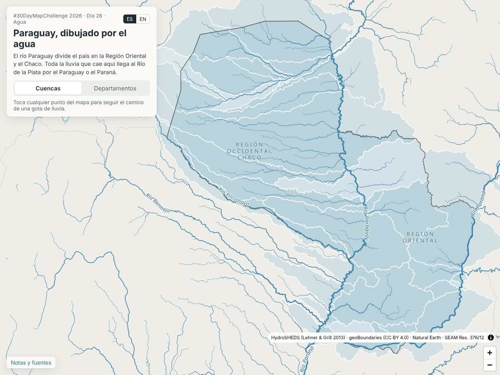

# Paraguay, dibujado por el agua / Paraguay drawn by water

#30DayMapChallenge 2026 · Día 26 / Day 26: **Water** (26 nov 2026)

**https://shinyanakashima.github.io/30daymapchallenge-2026day26-cuencas/**



## Español

Paraguay redibujado por sus cuencas hidrográficas en lugar de sus departamentos. El río Paraguay atraviesa el país de norte a sur y lo divide en la Región Oriental y el Chaco; toda la lluvia que cae en Paraguay llega al Río de la Plata por el río Paraguay o por el Paraná.

- Cambia entre **Cuencas** y **Departamentos** para comparar las dos formas de dividir el país.
- Toca cualquier punto del mapa: se dibuja el camino de una gota de lluvia hasta la boca del Río de la Plata, con los ríos por los que pasa, la distancia aproximada y los países que atraviesa.
- Al tocar una cuenca se muestran su superficie, a qué río desagua y la unidad hidrográfica oficial más cercana (Resolución SEAM N° 376/12).

## English

Paraguay redrawn by its river basins instead of its departments. The Paraguay River runs north to south through the country and splits it into the Eastern Region and the Chaco; every drop of rain that falls on Paraguay reaches the Río de la Plata through the Paraguay or the Paraná.

- Switch between **Basins** and **Departments** to compare the two ways of dividing the country.
- Tap anywhere on the map to draw the path of a raindrop to the mouth of the Río de la Plata, with the rivers it follows, the approximate distance and the countries it crosses.
- Tap a basin to see its area, the river it drains to and the closest official hydrographic unit (Resolution SEAM No. 376/12).

The page opens in Spanish; use the ES / EN switch or `?lang=en`.

## 日本語

パラグアイを、県（departamento）の境界ではなく流域で描き直した地図です。国の中央を南北に流れるパラグアイ川は国を東部（Región Oriental）と西部（チャコ）に分け、パラグアイに降った雨はすべてパラグアイ川かパラナ川を通ってラ・プラタ川へ流れます。

- 「Cuencas（流域）」と「Departamentos（県）」を切り替えて、二つの区分を見比べられます。
- 地図上の任意の場所をタップすると、雨粒がラ・プラタ川の河口まで流れる道筋を描き、通る川、およその距離、通る国を表示します。
- 流域をタップすると、面積、流れ込む川、近い公式の水文単位（SEAM 決議 376/12 号）を表示します。

## Datos y fuentes / Data and sources

| Capa / Layer | Fuente / Source | Licencia / Terms | Obtenido / Retrieved |
|---|---|---|---|
| Cuencas (nivel 6) y subcuencas (nivel 12) | HydroBASINS v1c, South America (`hybas_sa_lev01-12_v1c`), HydroSHEDS — https://www.hydrosheds.org/products/hydrobasins | HydroSHEDS License Agreement (technical documentation) | 2026-11-08 |
| Ríos y dirección de flujo | HydroRIVERS v1.0, South America (`HydroRIVERS_v10_sa_shp`), HydroSHEDS — https://www.hydrosheds.org/products/hydrorivers | HydroSHEDS License Agreement (technical documentation) | 2026-11-08 |
| Departamentos y límite nacional | geoBoundaries gbOpen PRY ADM0 / ADM1, build 9469f09 (fuente: Dirección General de Estadística, Encuestas y Censos, 2012) — https://www.geoboundaries.org/ | CC BY 4.0 | 2026-11-08 |
| Países vecinos y fondo | Natural Earth 1:10m Admin 0 Countries — https://www.naturalearthdata.com/ | Dominio público / Public domain | 2026-11-08 |
| Unidades hidrográficas oficiales | Resolución SEAM N° 376/12 «Por la cual se aprueba las unidades hidrográficas del Paraguay» (12 nov 2012), FAOLEX — https://faolex.fao.org/docs/pdf/par126126.pdf | Documento público | 2026-11-08 |

Citas / Citations:

- Lehner, B., Grill, G. (2013). Global river hydrography and network routing: baseline data and new approaches to study the world's large river systems. *Hydrological Processes*, 27(15), 2171–2186. https://doi.org/10.1002/hyp.9740
- Runfola, D. et al. (2020). geoBoundaries: A global database of political administrative boundaries. *PLOS ONE*, 15(4), e0231866. https://doi.org/10.1371/journal.pone.0231866

Map library: MapLibre GL JS 4.7.1 (BSD-3-Clause, `site/vendor/maplibre-gl/LICENSE.txt`). Label typeface: Noto Sans (SIL Open Font License, `site/fonts/OFL.txt`).

### Uso de las fuentes / How the sources are used

- **Cuencas**: las 36 cuencas HydroBASINS de **nivel 6** que tienen al menos 50 km² dentro de Paraguay, completas (muchas continúan en Argentina, Bolivia o Brasil). Su nombre se deriva del río principal que contienen; HydroBASINS no trae nombres.
- **Unidades oficiales**: la Resolución SEAM N° 376/12 define 17 unidades en la Región Oriental y 3 en la Occidental. El *Atlas de Cuencas Hidrográficas del Paraguay* (MADES, 2022) no se encontró como datos vectoriales descargables, por lo que no se usaron sus límites. Cada cuenca HydroBASINS se relaciona con una unidad oficial solo cuando contiene el río que da nombre a esa unidad (Apa, Aquidabán, Ypané, Jejuí Guazú, Manduvirá, Tebicuary, Pilcomayo) o desagua directamente en el Paraná desde la Región Oriental (áreas de influencia de Itaipú y Yacyretá). Las demás unidades (Caañabé, Laguna Verá, Ñeembucú, Piribebuy, Yhaguy, Ypacaraí y Patiño, Yacaré, Timané) no tienen correspondencia con las cuencas de nivel 6; la tabla completa con sus superficies figura en «Notas y fuentes».
- **Nombres de ríos**: HydroRIVERS no trae nombres. Los ríos principales se nombraron siguiendo la red desde un punto aguas arriba de cada uno hasta el río mayor en que desembocan (`scripts/build_data.py`, `SEEDS`).

## Cómo se traza el camino de la gota / How the raindrop path is traced

1. El área de análisis (las 36 cuencas) se cubre con una rejilla de 0,04°. Cada celda se asigna a la subcuenca HydroBASINS de nivel 12 que contiene su centro y al tramo de HydroRIVERS más cercano dentro de esa subcuenca.
2. Desde ese tramo se sigue `NEXT_DOWN` (el identificador del tramo siguiente aguas abajo) hasta un tramo con al menos 300 km² de área de drenaje; ese es el punto de entrada guardado para la celda (`site/data/grid.bin`).
3. En el navegador se sigue `NEXT_DOWN` desde el punto de entrada hasta el final de la red (`site/data/network.json`). HydroRIVERS termina el Paraná en su delta; el tramo final por el Río de la Plata es una línea esquemática de 318 km hasta la línea Punta Rasa–Punta del Este.
4. La distancia es la suma de `LENGTH_KM` de los tramos más la recta desde el punto tocado hasta el primer tramo.
5. Los países se obtienen del punto medio de cada tramo (Natural Earth); si está a menos de 2 km de un límite, el tramo se cuenta como frontera.

The analysed area is covered by a 0.04° grid; each cell is linked to the nearest HydroRIVERS reach inside its HydroBASINS level-12 sub-basin, and `NEXT_DOWN` is followed to the sea. The last leg across the Río de la Plata is schematic. Distances are sums of reach lengths and are approximate.

## Notas / Notes

- Las cuencas y los ríos provienen de los datos globales de HydroSHEDS (Lehner & Grill 2013) y sus límites pueden no coincidir con la división oficial de cuencas del Paraguay (Resolución SEAM N° 376/12).
  Basins and rivers come from the global HydroSHEDS data and may not match Paraguay's official basin division.
  流域と川は HydroSHEDS の全球データによるもので、パラグアイの公式の流域区分とは境界が一致しない場合があります。
- El camino de la gota sigue la dirección de flujo de los datos de ríos (HydroRIVERS); no considera aguas subterráneas ni canales artificiales.
  The raindrop path follows the flow direction of the river data; groundwater and artificial canals are not considered.
  雨粒の道筋は川のデータ（HydroRIVERS）の流れの向きによるもので、地下水や人工の水路は考慮していません。
- En el Chaco el relieve es muy plano y el drenaje real cambia con las crecidas; los datos globales lo simplifican.

## Estructura / Structure

```
site/                  sitio estático publicado en GitHub Pages
  index.html, app.js, style.css
  data/                capas generadas (GeoJSON, red de ríos, rejilla)
  fonts/, vendor/      tipografía y MapLibre GL JS
scripts/build_data.py  genera site/data a partir de los datos originales
docs/screenshot.png
```

Regenerar los datos / Rebuild the data (Python 3 with geopandas, pyogrio, shapely):

```
python3 scripts/build_data.py RAW_DIR
```

`RAW_DIR` debe contener los archivos descargados que se listan al inicio de `scripts/build_data.py`.

## Licencia / License

Código: MIT (ver `LICENSE`). Los datos conservan las licencias de sus fuentes.
